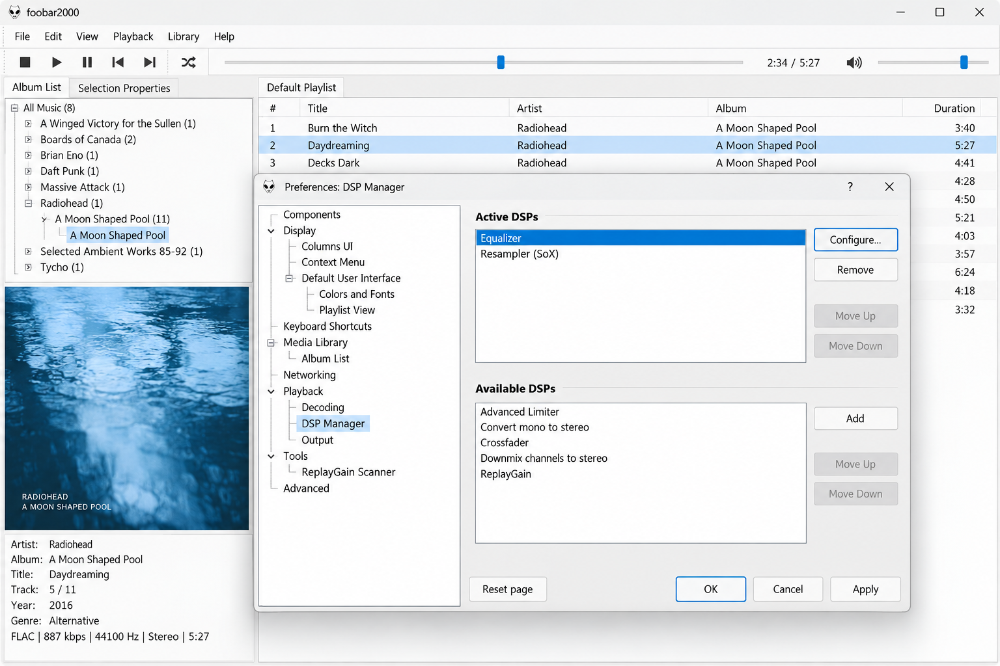
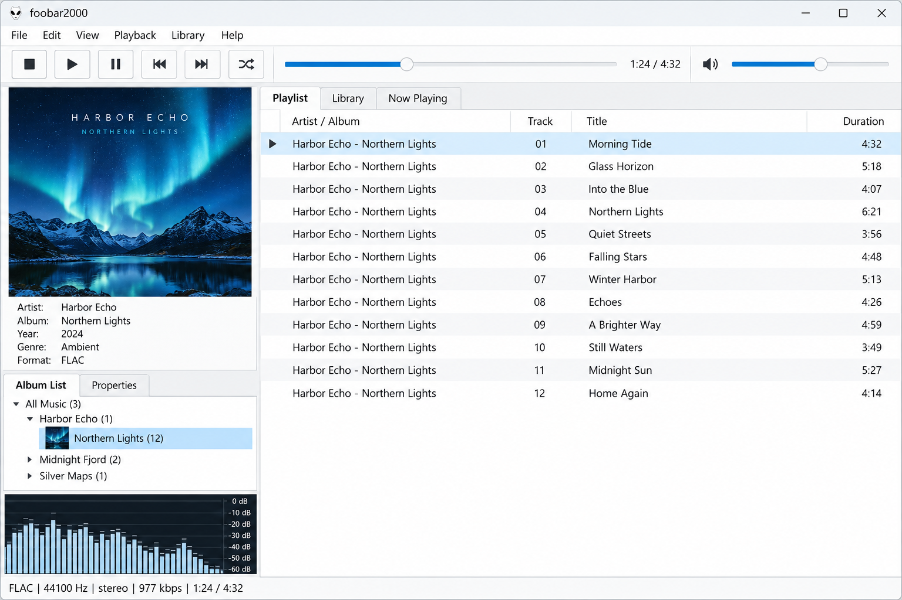
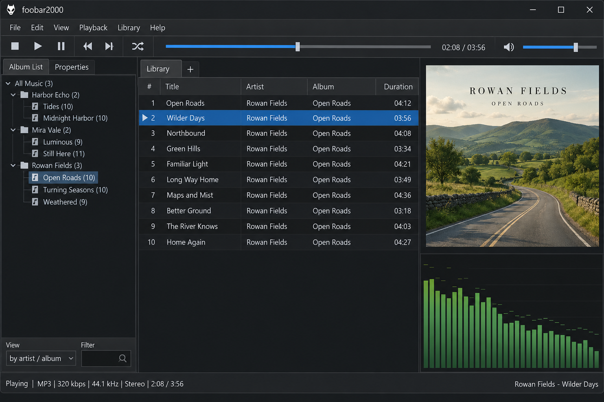

# Foobar2000 Components - Custom Themes, Panels, And Scripts

Foobar2000 Music Player is a community organization for extending and customizing the foobar2000 music player. The Foobar2000 Components repository brings together JavaScript modules for themes, playlists, library browsing, biography panels, lyrics, artwork, menus, and dynamic color handling.

Foobar2000 Components focuses on desktop layouts powered by compatible script panels. It is not the official foobar2000 application and does not include the player or required binary components.

## Features

- Dynamic colors generated from album artwork.
- Configurable themes, styles, presets, and automatic day and night modes.
- Artwork, compact, and playlist-focused layouts.
- Library views with album covers, artist images, search, and scrolling.
- Biography panels with artist information, images, and metadata.
- Lyrics presentation integrated with the active theme.
- Playlist grouping, headers, rows, controls, and properties.
- Context menus, playback controls, responsive sizing, and display helpers.
- Modular source files that make Foobar2000 Components easier to inspect and customize.
- Support for building foobar2000 themes and foobar2000 skins around a consistent interface.

### Why is foobar2000 so good?

Foobar2000 is valued because it combines efficient local audio playback with unusually deep customization. Foobar2000 components can replace or extend interface elements, while foobar2000 plugins can add specialized playback, tagging, visualization, and library functions.

The player also supports workflows such as foobar2000 gapless playback, foobar2000 replaygain, foobar2000 audio tagging, and foobar2000 audio converter operations. Advanced users can configure foobar2000 WASAPI, foobar2000 ASIO, foobar2000 DSD, foo_input_sacd, or foo_out_asio when compatible external components and audio hardware are available.

Foobar2000 Music Player builds on that flexibility by organizing interface code into focused modules. Foobar2000 Components provides dedicated systems for colors, playlists, library browsing, biography data, menus, lyrics, and settings instead of forcing every customization into one script.

## Requirements

- A compatible Windows installation of foobar2000.
- A script-panel environment capable of running the retained JavaScript modules.
- Matching component architecture for the installed player.
- A complete backup of the existing profile before replacing theme files.
- Appropriate fonts and external components when required by a chosen layout.

Foobar2000 Windows 10 and foobar2000 Windows 11 are the primary desktop environments represented by the source material. Foobar2000 64bit requires compatible 64-bit components, while older foobar2000 themes may still depend on 32-bit components. Mixing component architectures will not work.

Foobar2000 portable keeps its profile beside the player installation. A standard installation normally keeps profile data under the current Windows user account. Foobar2000 Components should be placed and configured according to the selected installation type.

## Downloads

## Installation Instructions

1. Close foobar2000 before changing its profile or panel configuration.
2. Back up the current profile, themes, scripts, and user components.
3. Keep the files from Foobar2000 Components together so that related modules can resolve their shared helpers.
4. Configure a compatible script panel to load the main theme entry point from [`src/gr-main.js`](src/gr-main.js).
5. Review [`georgia-reborn-custom.jsonc`](georgia-reborn-custom.jsonc) before applying custom theme values.
6. Start foobar2000 and verify the playlist, library, biography, artwork, menus, and playback controls.
7. Adjust the player size, layout, theme, and style from the interface after confirming that the panel loads correctly.

Foobar2000 Components contains source scripts rather than a complete foobar2000 distribution. Required fonts, binary components, and the player itself must match the environment in which the scripts are loaded.

For a foobar2000 portable setup, keep the theme resources under the portable profile. For a standard setup, use the profile associated with the current Windows account. Do not copy individual modules into unrelated locations unless their dependencies and include paths are updated together.

## Useful to know

Foobar2000 themes often build artwork caches gradually. The first display of an album or artist image can therefore be slower than later displays. If artwork changes but the old image remains visible, refresh the relevant panel or clear the theme cache through its available controls.

Many panels expose additional settings through a context menu. A compatible script panel may also expose its configuration command when the modifier key required by that host is held during a right-click.

The files retained in Foobar2000 Components are primarily JavaScript interface modules. General-purpose libraries described in the broader source material covered HTML parsing, query-string handling, ECMAScript utilities, localization, and regression testing. Those projects informed the surrounding ecosystem, but they are not presented here as standalone Foobar2000 Components features.

### In The Player's Language

foobar2000 music player, foobar2000 components, foobar2000 plugins, foobar2000 themes, foobar2000 skins, foobar2000 dsp plugins, audio-player, music-player, audio-playback, digital-audio, media-player, windows, foo_input_sacd, foo_out_asio

### Is foobar2000 better than Spotify?

Foobar2000 and Spotify solve different problems. Foobar2000 is designed around local files, user-controlled libraries, detailed metadata, configurable output, and extensible desktop interfaces. Spotify is primarily a hosted streaming service with a managed catalog and account-based discovery.

Foobar2000 Music Player is more suitable when ownership of files, format support, custom playback chains, and interface control are priorities. Foobar2000 Components strengthens that local workflow with library, playlist, artwork, biography, and theme modules. It does not turn foobar2000 into Spotify or provide a native streaming catalog.

### Is foobar2000 better than VLC?

Foobar2000 is generally more focused on music-library management and configurable audio playback, while VLC is a broad media player designed for many audio and video formats. Foobar2000 Components is particularly useful when the goal is a tailored music interface with playlists, artwork, metadata, biographies, lyrics, and dynamic themes.

VLC may be more convenient for occasional video playback or opening miscellaneous media without building a library. Foobar2000 Music Player is the stronger fit for listeners who want persistent music organization, foobar2000 replaygain, foobar2000 gapless playback, specialized output components, and detailed interface customization.

## Usage

The main theme is coordinated by [`src/gr-main.js`](src/gr-main.js), with initialization handled by [`src/gr-initialize.js`](src/gr-initialize.js). Shared interface behavior is divided into focused modules rather than one large configuration file.

| Area | Main file | Purpose |
|---|---|---|
| Theme | [`src/gr-color-themes.js`](src/gr-color-themes.js) | Coordinates selectable color themes. |
| Presets | [`src/gr-theme-presets.js`](src/gr-theme-presets.js) | Manages predefined theme combinations. |
| Display | [`src/gr-display.js`](src/gr-display.js) | Handles visual presentation and layout behavior. |
| Playlist | [`src/pl-main.js`](src/pl-main.js) | Coordinates playlist rendering and interaction. |
| Library | [`src/lib-main.js`](src/lib-main.js) | Coordinates browsing, search, and library views. |
| Biography | [`src/bio-main.js`](src/bio-main.js) | Coordinates artist text, images, and related panels. |
| Lyrics | [`src/gr-lyrics.js`](src/gr-lyrics.js) | Integrates lyric presentation with the theme. |
| Menus | [`src/gr-menu-manager.js`](src/gr-menu-manager.js) | Builds and manages interface menus. |

### What is foobar2000 used for?

Foobar2000 is used to play, organize, tag, inspect, and convert digital audio collections. Common workflows include foobar2000 FLAC playback, foobar2000 FLAC to MP3 conversion, foobar2000 CD ripping, playlist management, ReplayGain analysis, and metadata editing.

Enthusiasts also use foobar2000 equalizer settings, foobar2000 DSP plugins, foobar2000 VU meter displays, and foobar2000 analog VU meter layouts. Hardware-focused configurations may use foobar2000 ASIO or foobar2000 WASAPI output, while compatible extensions can support foobar2000 DSD playback.

Foobar2000 mobile is available separately for handheld platforms, including foobar2000 Android, foobar2000 iPhone, and foobar2000 iOS. The scripts in Foobar2000 Components are desktop interface sources and should not be treated as foobar2000 mobile skins. Foobar2000 Linux use also depends on a compatible environment because the retained interface code is centered on the Windows desktop ecosystem.

## Development

Foobar2000 Components uses modular JavaScript. Theme behavior is separated into color, configuration, display, menu, setup, and helper files. Playlist, library, and biography systems follow the same pattern.

Useful entry points include:

- [`src/gr-main-components.js`](src/gr-main-components.js) for primary theme components.
- [`src/gr-config.js`](src/gr-config.js) and [`src/gr-config-defaults.js`](src/gr-config-defaults.js) for configuration behavior.
- [`src/gr-color-manager.js`](src/gr-color-manager.js) for dynamic color coordination.
- [`src/pl-components.js`](src/pl-components.js) for playlist elements.
- [`src/lib-interface.js`](src/lib-interface.js) for library presentation.
- [`src/bio-interface.js`](src/bio-interface.js) for biography presentation.
- [`src/foo_spider_monkey_panel.js`](src/foo_spider_monkey_panel.js) for the retained panel integration source.

### Build instructions

Foobar2000 Components is loaded by its compatible host panel and is not a standalone browser application. Keep related modules in the same source hierarchy, apply formatting rules from [`.editorconfig`](.editorconfig) and [`.prettierrc.json`](.prettierrc.json), and review [`package.json`](package.json) before using any package scripts.

Test interface changes inside a disposable foobar2000 profile. Verify startup, playback controls, playlist scrolling, library navigation, artwork loading, biography rendering, lyrics, context menus, theme switching, and window resizing. Both light and dark configurations should remain readable.

## Documentation

Additional retained documentation is available in [`README.html`](README.html). Release history is recorded in [`CHANGELOG.md`](CHANGELOG.md), and repository contribution expectations are described in [`CONTRIBUTING.md`](CONTRIBUTING.md).

## Contributing

Bug reports and focused pull requests are welcome. Keep changes limited to a clear theme, panel, playlist, library, or biography concern. New behavior should preserve existing layouts and include enough testing information to reproduce the result.

When changing Foobar2000 Components:

1. Follow the existing module boundaries.
2. Avoid combining unrelated refactoring with a feature fix.
3. Test the affected panel in a clean profile.
4. Check different window sizes and artwork states.
5. Confirm that missing biography, lyric, or artwork data fails gracefully.
6. Document user-visible changes in [`CHANGELOG.md`](CHANGELOG.md).

## Support

Use the repository issue tracker for reproducible defects in Foobar2000 Components. Include the foobar2000 version, architecture, Windows version, panel host version, active layout, and steps required to reproduce the problem.

Problems caused by incompatible external binaries, missing fonts, or mixed 32-bit and 64-bit components should be isolated before reporting a script defect.

## Help

Developers familiar with JavaScript, foobar2000 components, foobar2000 plugins, playlist rendering, artwork processing, or dynamic color systems can help improve performance and compatibility. Small, reviewable changes are easier to validate than complete rewrites.

## Thanks

Foobar2000 Music Player builds on ideas and work from the foobar2000 community, including Georgia-ReBORN, Georgia, Columns UI, Spider Monkey Panel, Library Tree, Biography, Eole, and OpenLyrics contributors. Their work established many of the patterns represented by Foobar2000 Components.

## Source code licence

The applicable source terms are provided in [`LICENSE`](LICENSE). Review them before redistributing modified Foobar2000 Components or incorporating the files into another theme.
